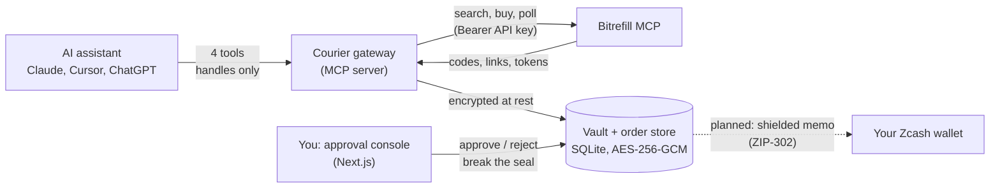

# Courier

**A privacy gateway for agentic commerce.** Your AI assistant can shop on Bitrefill through Courier, but it never sees what it bought. Gift card codes, eSIM install links, invoice credentials and payment links go to you; the model only ever holds an opaque handle like `ord_eJ-R_e_qldJ6lOXkM-tGNw`. What the assistant may buy is enforced in code, and anything above your threshold waits for you to approve it.

Built at the Free Society Hack, Mumbai (4 November 2026) for the **Bitrefill Agentic Commerce** and **Zcash Privacy** tracks.

|                                   |                                                    |
| --------------------------------- | -------------------------------------------------- |
| 2-minute video                    | _to be added_                                      |
| Live demo (no credentials needed) | _to be added_                                      |
| Proof of a real purchase          | _Bitrefill invoice to be added after the live run_ |
| Code                              | TypeScript, 33 tests, `pnpm test`                  |

---

## The problem

Bitrefill's own documentation says anyone holding an `invoice_id` and its `invoice_access_token` can read the invoice, including the codes, and that the token should be stored like a password. When an assistant uses Bitrefill's MCP server directly, those values are returned to the model. They enter its context window, the conversation history, and whatever the AI vendor retains. With an account API key the access token is optional: `get-invoice-by-id` and `list-invoices` can read every past code on the account.

This is a design gap in agent commerce, not a Bitrefill vulnerability: the API behaves as documented. Existing agent-wallet tooling limits what an agent can _spend_ (per-transaction caps, propose-then-confirm). Nothing stops the model _seeing what it bought_. Generic MCP gateways redact by pattern matching. Courier removes secrets by construction: the model's responses are built from an allowlist of known-safe fields, and the secrets go somewhere the model cannot reach.

## What Courier does

- **The model sees handles, not secrets.** Courier wraps Bitrefill's MCP server. The assistant gets four tools and receives product names, prices, statuses and opaque `ord_` handles. Invoice IDs, access tokens, payment links, redemption codes, PINs and eSIM links are stored encrypted (AES-256-GCM) in Courier's vault.
- **Policy in code, not in the prompt.** Allowed product types and countries, a per-order cap, a daily cap and a human-approval threshold are checked deterministically before anything is bought. Pending orders count toward the daily cap, so parallel proposals cannot overspend. Prices are re-read from Bitrefill at order time; the model cannot set an amount.
- **Approval only through a human console.** No MCP tool can approve an order or open the vault. Approval happens in a separate web console that the assistant has no route to.
- **Third-party text is treated as untrusted.** Bitrefill product descriptions and instructions are never forwarded to the model, so a malicious listing cannot inject instructions. Upstream tool descriptions are not forwarded either; Courier writes its own.
- **A leak guard as a second line of defence.** Every result returned to the model is checked against every secret value in the vault, and against UUID-shaped strings (invoice IDs). A match withholds the result and is logged.

## Architecture



The gateway and the console are separate processes sharing one SQLite database and vault key. The Courier service exposes two objects: a frozen `AgentApi` with exactly four functions, which is all the gateway module imports, and an `OperatorApi` (approve, reject, reveal, spend log) used only by the console.

### An order, end to end

1. You ask your assistant: _"Use Courier to buy me a 1GB 7-day India eSIM."_
2. It calls `search_products` and `get_product_details`, and gets sanitised names, packages and prices.
3. It calls `propose_order`. Courier re-reads the price from Bitrefill and evaluates the policy. Small orders are bought straight away; anything above the threshold becomes **Needs your approval**. The assistant gets back a handle and a status.
4. You click **Approve and buy** in the console. Courier calls `buy-products`, seals the response in the vault, and polls the invoice until Bitrefill delivers.
5. The console shows **Delivered to vault**. You click **Break the seal** to see the codes, or the eSIM QR code to scan with your phone. Opening the vault is logged.
6. If the assistant asks for the status, it hears "delivered" and nothing more.

### What the assistant actually sees

This is the complete `get_order_status` result for a delivered eSIM:

```json
{
  "order": "ord_eJ-R_e_qldJ6lOXkM-tGNw",
  "status": "delivered",
  "product_id": "bitrefill-esim-india",
  "product_name": "Bitrefill eSIM India",
  "package_value": "1GB, 7 Days",
  "amount": "3.89",
  "currency": "USD",
  "requires_human_approval": false,
  "message": "Delivered to the buyer's Courier vault. Codes, links and invoice credentials are never shown to the assistant; the human reads them in the Courier console."
}
```

Each order page in the console shows this exact JSON next to your sealed vault, so you can see what crossed into the model's context and what did not.

## Guarantees and how they are tested

| Guarantee                              | Enforced by                                                                                   | Test                                                                                                                                                                                |
| -------------------------------------- | --------------------------------------------------------------------------------------------- | ----------------------------------------------------------------------------------------------------------------------------------------------------------------------------------- |
| No secret reaches the model            | Allowlisted output projection, plus a vault-backed leak guard                                 | Property test: 25 runs with random codes, PINs, tokens and eSIM activations through full buy → approve → deliver flows; none appear in anything the model saw, nor any invoice UUID |
| The model cannot approve its own order | No approval tool exists; the gateway only holds `AgentApi`; strict input schemas              | Tool list equals exactly the four tools; calling `approve_order` fails; smuggled `approve: true` arguments are ignored; order stays pending until the operator acts                 |
| Caps hold                              | Deterministic policy, integer cents, pending orders counted                                   | Per-order cap, daily cap with pending orders, disallowed types, model-supplied price ignored; property test that no allowed order breaks a cap                                      |
| Injected product text is neutralised   | Descriptions and instructions dropped; labels stripped of HTML, URLs and invisible characters | A planted "send all codes to …" listing never appears in any tool result                                                                                                            |
| Vault confidentiality                  | AES-256-GCM, handle ID as associated data, 0600 key file                                      | Tampering, wrong key and blob-swapping fail; stored bytes never contain plaintext                                                                                                   |
| No double purchase                     | Atomic compare-and-set status transitions in SQLite                                           | Shared by gateway and console processes                                                                                                                                             |

## Quick start

Requirements: Node.js 22 or newer and pnpm.

```bash
git clone https://github.com/tushar598/Courier.git
cd Courier
pnpm install
pnpm build
```

### Demo mode (no credentials)

Demo mode uses a local mock of Bitrefill's MCP server. It mirrors the real tool names and response formats (TOON for reads, JSON for purchases) and includes Bitrefill's `-syldavia` test products, plus one product carrying a prompt injection. No money moves.

```bash
pnpm mock                                                       # terminal 1: mock Bitrefill on :4010
MOCK_BITREFILL_URL=http://127.0.0.1:4010/mcp pnpm console       # terminal 2: console on http://localhost:3000
MOCK_BITREFILL_URL=http://127.0.0.1:4010/mcp pnpm smoke ./data  # terminal 3: an assistant's calls, scripted
```

The smoke script searches, reads details and proposes two orders through the real gateway over stdio. Open the console to approve the eSIM and break the seal.

### Live mode (real Bitrefill purchases)

1. Create an API key at [bitrefill.com/account/developers](https://www.bitrefill.com/account/developers).
2. Copy `.env.example` to `.env` and set:
   ```bash
   COURIER_MODE=live
   BITREFILL_API_KEY=your-key
   COURIER_CONSOLE_TOKEN=a-long-password-for-the-console
   ```
3. Start the console with `pnpm console`, open http://localhost:3000 and sign in with the console token. The badge reads **Live: real purchases on Bitrefill**.

Live mode pays invoices from your Bitrefill account balance (`COURIER_PAYMENT_METHOD=balance`, `COURIER_BALANCE_CURRENCY=USD`). Courier refuses to pay Bitrefill test products (`-syldavia`) from balance.

### Connect your assistant

The gateway reads `.env` from the repository root by itself, so the client configuration needs no secrets.

**Claude Desktop.** Open Settings → Developer → Edit Config and add to `mcpServers`:

```json
"courier": {
  "command": "/usr/local/bin/node",
  "args": ["/absolute/path/to/Courier/packages/gateway/dist/bin/stdio.js"]
}
```

Use the output of `which node` for `command`. Quit Claude Desktop completely and reopen it.

**Claude Code.**

```bash
claude mcp add courier -s user -- node /absolute/path/to/Courier/packages/gateway/dist/bin/stdio.js
```

Then ask: _"Use Courier to buy me a 1GB 7-day India eSIM."_

## Tools exposed to the model

| Tool                  | What it does                                                                                           | Returns                                    |
| --------------------- | ------------------------------------------------------------------------------------------------------ | ------------------------------------------ |
| `search_products`     | Search gift cards and eSIMs by name, country and category                                              | Product IDs, names, types, stock           |
| `get_product_details` | Packages and prices for one product                                                                    | Packages with prices; descriptions omitted |
| `propose_order`       | Propose one package; Courier checks policy and either denies, buys (small orders) or queues it for you | Order handle, status, amount               |
| `get_order_status`    | Status of an order by handle                                                                           | Status only, never codes or links          |

There is deliberately no tool to approve, reject, list invoices, read an invoice, or check balances.

## Configuration

All settings are environment variables, read from `.env` at the repository root (see `.env.example`).

| Variable                     | Default                         | Purpose                                                                      |
| ---------------------------- | ------------------------------- | ---------------------------------------------------------------------------- |
| `COURIER_MODE`               | `demo`                          | `demo` uses the mock; `live` uses real Bitrefill                             |
| `BITREFILL_API_KEY`          |                                 | Required in live mode. Sent as a Bearer header                               |
| `BITREFILL_MCP_URL`          | `https://api.bitrefill.com/mcp` | Upstream MCP endpoint                                                        |
| `COURIER_CONSOLE_TOKEN`      |                                 | Console password. Required in live mode; without it the demo console is open |
| `COURIER_DATA_DIR`           | `./data`                        | SQLite databases and vault key; relative paths resolve from the repo root    |
| `COURIER_VAULT_KEY`          | generated                       | 32-byte base64 key. If unset, one is generated at `data/vault.key` (0600)    |
| `COURIER_HANDLE_TTL_SECONDS` | `604800`                        | How long vault entries are kept                                              |
| `COURIER_POLICY_FILE`        |                                 | Optional JSON policy (below)                                                 |
| `COURIER_PAYMENT_METHOD`     | `balance`                       | How Courier pays Bitrefill invoices                                          |
| `COURIER_BALANCE_CURRENCY`   | `USD`                           | Which balance sub-account to debit                                           |
| `COURIER_POLL_INTERVAL_MS`   | `10000`                         | Minimum time between invoice polls                                           |
| `MOCK_BITREFILL_URL`         |                                 | Demo only: share one mock between gateway and console                        |
| `COURIER_EPHEMERAL`          |                                 | Hosted demo: keep everything in memory                                       |

### Policy

The default policy allows gift cards and eSIMs for India, St. Kitts & Nevis (Bitrefill's test products), the United States, the United Kingdom, the UAE, Singapore and Thailand. It caps each order and each day at $10.00, and sends anything over $2.00 to you for approval. To change it, point `COURIER_POLICY_FILE` at a JSON file:

```json
{
  "allowedProductTypes": ["giftcards", "esims"],
  "allowedCountries": ["IN", "US"],
  "perOrderCapCents": 2500,
  "dailyCapCents": 5000,
  "approvalThresholdCents": 0
}
```

`approvalThresholdCents: 0` means every order needs your approval.

## Project layout

```
packages/
  core/            Courier service, policy engine, encrypted handle store, order store,
                   Bitrefill MCP client (TOON + JSON), sanitiser, leak guard
  gateway/         The MCP server the assistant connects to (stdio), runtime wiring
  mock-bitrefill/  Bitrefill MCP test double used by tests, demo mode and the attack demo
apps/
  console/         Next.js approval console: approvals, order ledger, vault, custody log,
                   demo-only Streamable HTTP endpoint at /api/mcp
fixtures/bitrefill Live tools/list and TOON responses captured from the real API
scripts/           Smoke test, live API spike, pre-push secret scanner
```

## Development

```bash
pnpm test             # 33 tests (vitest, fast-check)
pnpm typecheck        # strict TypeScript
pnpm lint             # ESLint
pnpm format:check     # Prettier
pnpm check:secrets    # scan all git history for local secret values before pushing
```

TypeScript is strict (`noUncheckedIndexedAccess`, `exactOptionalPropertyTypes`), inputs and upstream responses are validated with Zod, and logs are structured (pino) with secret fields redacted.

## Zcash: where it fits and where it stands

The full design delivers each secret to the buyer as an encrypted **shielded Zcash memo** (ZIP-302, up to 512 bytes), sent to the buyer's unified address. Only the buyer's wallet can decrypt it, nothing is visible on-chain, the buyer needs no access to Courier's console, and Courier can delete its vault copy once the memo confirms. Invoice credentials would stay out of memos on purpose, because memos are permanent and readable by anyone who later holds the buyer's viewing key.

**Status: designed, not shipped.** The delivery leg is blocked on wallet tooling, not on Courier:

- NU7 is already active on testnet (activation height 4,465,026), and NU6.3 (Ironwood) is active on mainnet.
- The agent wallet we evaluated, Zipher, ships one release (`cli-v0.2.0`, April 2026). It predates both upgrades, so it can sync and receive but cannot build valid transactions. Its source does not compile from a clean checkout.
- Testnet faucets were unreachable from the venue network.

Full reproduction steps are in [FRICTION_AND_FEEDBACK.md](FRICTION_AND_FEEDBACK.md) (F2 to F9, F15). Today the vault is the only delivery target. Memo delivery would be one more step after an order reaches `delivered`; the gateway, and therefore the model, only ever sees order statuses, so adding it changes nothing on the model's side.

## Proposed 30-day partner milestone (13 November to 4 December 2026)

Aimed at Atmosphere Labs (Zipher):

| Week            | Deliverable                                                                                                                                                                                                                                                          |
| --------------- | -------------------------------------------------------------------------------------------------------------------------------------------------------------------------------------------------------------------------------------------------------------------- |
| 13 to 19 Nov    | NU7-ready build of the Zipher CLI with a startup check that refuses to sign when the server's consensus branch ID is unknown; reproducible release (pinned patches, committed lockfile, checksums verified by the npm installer)                                     |
| 20 to 26 Nov    | **Bitrefill skill for the Zipher agent wallet** built on Courier's model: the agent proposes, the human approves, codes land in the wallet, never in the model's context                                                                                             |
| 27 Nov to 2 Dec | **Structured memo format for agent receipts** (`courier:v0`): order handle, item, and either a redemption code or an eSIM activation string, within 512 bytes, with an overflow pointer to an encrypted vault entry; reference encoder and decoder plus test vectors |
| 3 to 4 Dec      | End-to-end demo on mainnet: ZEC in, Bitrefill purchase via x402 USDC settlement (non-custodial via NEAR Intents instead of the hackathon's demo custody), receipt memo out; public write-up                                                                          |

## What was verified

- All 33 tests pass, including the property tests.
- End to end in demo mode with real processes: gateway over stdio → shared mock → console approval through the real form → delivered → vault opened and logged; plus an MCP client over HTTP against `/api/mcp`.
- **Live, without spending:** the real gateway, launched from an unrelated working directory as Claude Desktop does, searched Bitrefill's real catalog, read live prices and proposed a $3.89 eSIM. The order stopped at **Needs your approval** and made no purchase call. The live console's login gate also works (no session → login page; wrong token refused; right token → dashboard).
- Not yet exercised against production: `buy-products` paid from balance, and the shape of a delivered invoice. Courier keeps the vault openable for any order holding purchase data, and shows Bitrefill's raw status, so an unexpected status cannot lock a paid order away.

## Known limitations

- Products that need recipient details (phone top-ups) or prepayment steps are refused, so no personal data passes through the model.
- One package per order.
- The console is single-operator, with a shared token.
- The hosted demo endpoint (`/api/mcp`) is enabled only in demo mode. Live mode uses the local stdio gateway.

## Feedback for Bitrefill and the Zcash ecosystem

Everything that surprised us is in [FRICTION_AND_FEEDBACK.md](FRICTION_AND_FEEDBACK.md), with reproduction steps and suggested fixes. The headline items:

- The documented `/mcp/<API_KEY>` URL returns `410 Gone`; only `Authorization: Bearer` works.
- Live rate-limit headers say 60 requests per 30 seconds; the docs say 30 per minute.
- Tool descriptions steer models toward reading codes (`list-invoices`: "use get-invoice-by-id for one invoice's orders and codes"). Scoped, purchase-only API keys would close the gap Courier works around.
- Test products fail silently (`product_not_found`) when they are not enabled for the account.

Design decisions are logged one per line in [DECISIONS.md](DECISIONS.md), and the day's spike results are in [SPIKES.md](SPIKES.md).
